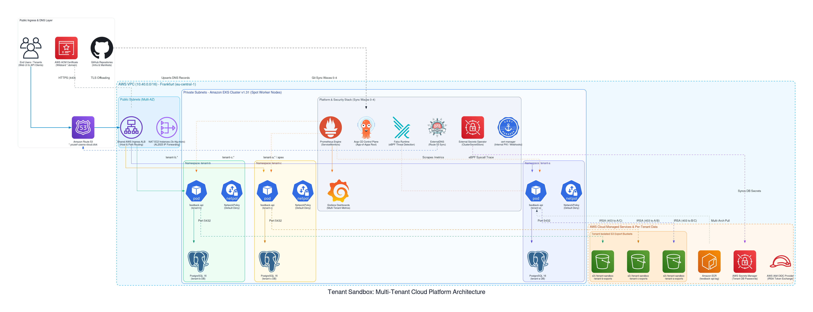
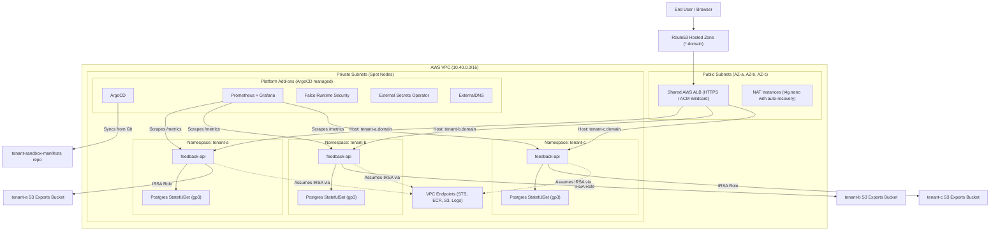

# Tenant Sandbox Infra

Terraform for a cost-conscious EKS portfolio/demo platform where each tenant is isolated in a Kubernetes namespace.

This repo owns AWS infrastructure and only the minimum in-cluster bootstrap components:

- VPC, private EKS nodes, public load balancer subnets
- One low-cost NAT instance per AZ instead of NAT Gateways
- VPC endpoints for ECR, S3, STS, and CloudWatch Logs
- EKS cluster and managed spot node group
- ECR repository for the feedback API
- IRSA roles for platform add-ons and tenant service accounts
- AWS Load Balancer Controller and ArgoCD

ArgoCD owns everything else from the `tenant-sandbox-manifests` repo.

## Architecture



<details>
<summary><b>Click to view declarative Mermaid architecture flowchart</b></summary>


</details>

## Local-Only Status

The files in this repo are safe to create locally. Nothing is deployed until you run Terraform commands such as `terraform apply`.

## Bootstrap

Terraform remote state is intentionally bootstrapped outside the main Terraform stack to avoid a chicken-and-egg dependency.

Replace the bucket name with a globally unique value:

```bash
export AWS_REGION=eu-central-1
export TF_STATE_BUCKET=tenant-sandbox-tfstate-REPLACE_ME
export TF_LOCK_TABLE=tenant-sandbox-tf-locks

aws s3api create-bucket \
  --bucket "$TF_STATE_BUCKET" \
  --region "$AWS_REGION" \
  --create-bucket-configuration LocationConstraint="$AWS_REGION"

aws s3api put-bucket-versioning \
  --bucket "$TF_STATE_BUCKET" \
  --versioning-configuration Status=Enabled

aws s3api put-bucket-encryption \
  --bucket "$TF_STATE_BUCKET" \
  --server-side-encryption-configuration '{"Rules":[{"ApplyServerSideEncryptionByDefault":{"SSEAlgorithm":"AES256"}}]}'

aws dynamodb create-table \
  --table-name "$TF_LOCK_TABLE" \
  --attribute-definitions AttributeName=LockID,AttributeType=S \
  --key-schema AttributeName=LockID,KeyType=HASH \
  --billing-mode PAY_PER_REQUEST \
  --region "$AWS_REGION"
```

The backend is configured for the existing `tenant-sandbox-tfstate` bucket with S3-native state locking. The existing `tenant-sandbox-tf-locks` DynamoDB table is retained but no longer required. Copy `envs/dev/terraform.tfvars.example` to `envs/dev/terraform.tfvars`; leave `allowed_admin_cidr` unset to detect your current public IPv4 address when Terraform applies.

## GitHub OIDC Bootstrap

The `bootstrap/github-oidc` directory creates the GitHub OIDC provider and a bootstrap role that GitHub Actions can assume. Apply it only after updating the repo names and account values.

```bash
cd bootstrap/github-oidc
terraform init
terraform plan
terraform apply
```

## Main Infra Apply

```bash
cd envs/dev
terraform init
terraform plan
terraform apply
```

After the EKS cluster exists:

```bash
aws eks update-kubeconfig --region eu-central-1 --name tenant-sandbox
kubectl get nodes
```

## Changing networks

Terraform detects the public IPv4 address at apply time, so it does not revert a current-network update on the next apply. If you move networks after the cluster exists, run this from any network with AWS CLI credentials:

```bash
./scripts/update-admin-cidr.sh
```

The script updates the EKS public-endpoint allowlist to the current IPv4 `/32`, preserves private endpoint access, and waits for the update to finish. It intentionally grants only the current address; use a fixed CIDR in `terraform.tfvars` instead if you need several administrators or a VPN range.

## Cost-Conscious Trade-Offs

| Decision | Why | Trade-off |
| --- | --- | --- |
| NAT instance | Much cheaper than NAT Gateway for a short demo | Less available and less managed |
| Spot node group | Keeps compute cost low | Nodes can be interrupted |
| In-cluster Postgres | Avoids RDS cost | Not production-grade database operations |
| VPC endpoints | Reduces NAT traffic for AWS APIs/image pulls | Adds endpoint hourly cost |
| Terraform installs only ArgoCD and AWS LB Controller | Avoids destroy-order problems | Requires GitOps repo for the rest |

## Teardown

Delete ArgoCD-managed applications first from the manifests repo or ArgoCD UI, then destroy Terraform:

```bash
cd envs/dev
terraform destroy
```

The GitHub Actions workflow also includes a manual destroy entry point for the demo account.

## Public ingress and TLS

Terraform creates and DNS-validates an ACM certificate for `yousef-usama-cloud.click` and its subdomains. The AWS Load Balancer Controller discovers that certificate and terminates HTTPS on the shared ALB. ExternalDNS publishes the tenant hostnames in the Route 53 hosted zone. This deliberately avoids using cert-manager TLS Secrets for ALB termination, because ALB requires ACM certificates.

## 🛠️ Infrastructure Lessons Learned & Troubleshooting

During provisioning, security hardening, and teardown, several real-world cloud edge cases were resolved:

1. **GitHub Actions OIDC Subject Claim Format**:
   - *Error*: `sts:AssumeRoleWithWebIdentity` AccessDenied.
   - *RCA*: GitHub Actions tokens contain numerical account identifiers (e.g. `repo:org@123/repo@456:ref:...`). Strict equality checks in the IAM trust policy rejected valid tokens.
   - *Fix*: Configured the OIDC trust policy condition using `StringLike` with `repo:yousef-usama*tenant-sandbox-manifests*:*`.

2. **AWS Load Balancer Controller IAM Policy**:
   - *Error*: Controller unable to discover ACM wildcard certificate or configure HTTPS 443 listeners.
   - *RCA*: Standard AWS LBC minimum policy lacked `acm:DescribeCertificate` and `wafv2:*` permissions.
   - *Fix*: Updated `aws-load-balancer-controller.json` to the comprehensive v2.8+ specification.

3. **Teardown Dependency Order (ALB, S3 Versioning & ACM Eventual Consistency)**:
   - *Error*: `BucketNotEmpty` on S3 buckets and `ResourceInUseException` on ACM certificate during `terraform destroy`.
   - *RCA*: Versioned S3 buckets retain versions even after standard delete commands. In addition, AWS ACM takes up to several minutes to asynchronously clear internal `InUseBy` associations after an ALB is deleted in ELBv2.
   - *Fix*: Orchestrated teardown sequence: cascade-delete ArgoCD Ingresses first, purge all object versions and delete markers from S3 (`aws s3api delete-objects`), and ensure ALB termination completes before destroying VPC subnets and the ACM certificate.

4. **Terraform Heredoc Indentation & Amazon Linux 2023 NAT Packet Forwarding**:
   - *Error*: Private subnet EKS nodes unable to route egress traffic to external package repos; NAT EC2 cloud-init logs reported `Exec format error` executing `/var/lib/cloud/instance/scripts/part-001`.
   - *RCA*: Terraform's heredoc `<<-` strips leading whitespace equivalent to the *least-indented* non-empty line. Because an inner line had 0 spaces, the shebang `#!/bin/bash` retained 4 leading spaces, preventing the kernel from parsing the script. Additionally, Amazon Linux 2023 manages interfaces via `systemd-networkd`, which overrides standard `sysctl` IPv4 forwarding on DHCP lease renewal unless explicitly enabled in the network unit.
   - *Fix*: Aligned all userdata lines to column 0 in `modules/vpc/main.tf`, wrote `/etc/systemd/network/80-ec2.network.d/nat.conf` with `[Network] IPForward=yes`, and applied persistent `iptables -t nat -A POSTROUTING -o enX0 -j MASQUERADE`.

